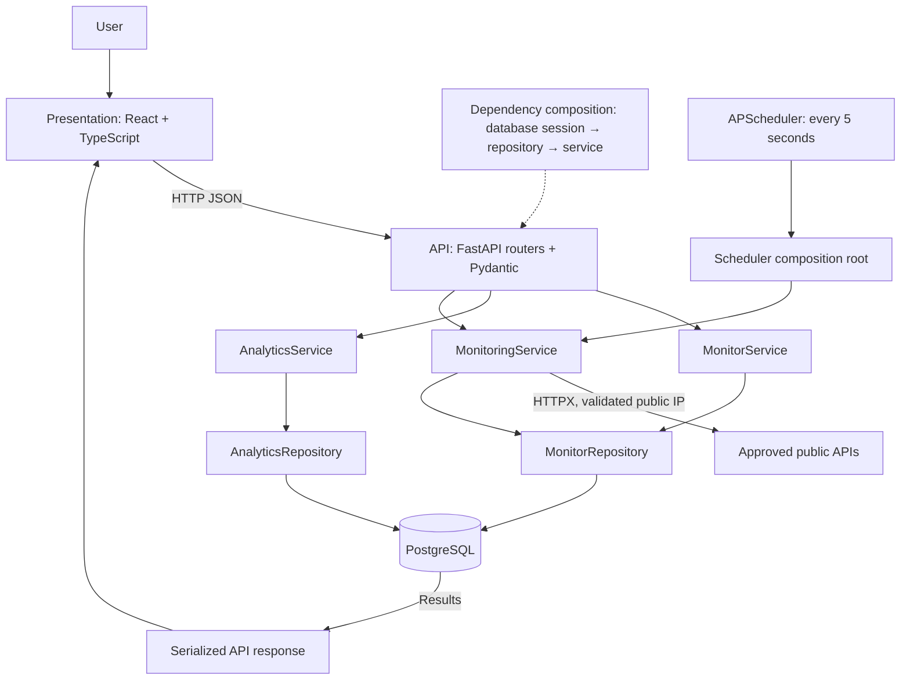

# Layered Architecture with the Service–Repository Pattern

## Five components

| Layer | Implementation | Responsibilities | Excluded responsibilities |
|---|---|---|---|
| Presentation | React components, App state, frontend fetch client | Forms, dashboard, charts, polling, loading/error states | SQL, health probes, incident decisions |
| API | `app/routes/`, `schemas.py` | Routes, HTTP status codes, validation, serialization | Business rules, sessions, database queries |
| Service | `app/services/` | Monitor lifecycle rules, health checks, incident transitions, due-job selection, analytics composition | SQL statements, FastAPI dependencies |
| Repository | `app/repositories/` | SQLAlchemy CRUD, raw SQL aggregates, filtering, pagination, commits/rollback | HTTP routing, UI, network probes |
| Database | PostgreSQL, `models.py`, `schema.sql` | Durable storage, foreign keys, constraints, indexes | Application workflow |

The diagram's return arrow summarizes the reverse path: repository results return through the service and API response models before reaching React. The database never communicates directly with the browser.

## Dependency injection

`get_db()` yields a request-scoped SQLAlchemy session. `dependencies.py` constructs a repository around that session and injects the appropriate service into each router using FastAPI `Depends`. Routers call service methods and return their results. `main.py` translates `NotFoundError` to HTTP 404 and `ConflictError` to HTTP 409. Database errors become a generic HTTP 503 without exposing connection details.

The scheduler is a second composition root. It opens a session for discovering due monitors and a separate session for each check. It does not send requests to the application's HTTP API. Both scheduled and manual checks use `MonitoringService.check()`.

`MonitoringService` accepts an optional asynchronous probe callable. Its repository can be replaced with a simple mock. `test_services.py` verifies failure detection, recovery, lock cleanup, and overlapping-check rejection without running SQL or FastAPI. No abstract base classes, dependency containers, or generic repository framework are necessary for this project.

## Data flow: create a monitor

1. The form requests the approved endpoint list and submits JSON.
2. Pydantic validates the name, allowlisted URL, interval and active state.
3. The router delegates to `MonitorService.create()`.
4. `MonitorRepository.save()` inserts and commits the model; uniqueness violations become a domain conflict.
5. FastAPI serializes `MonitorOut` with HTTP 201.
6. React refreshes the summary; the next scheduler scan sees the new active monitor.

## Data flow: check and incident transition

1. A scheduler tick or manual API action invokes the monitoring service.
2. The service rejects paused monitors and overlapping work, then performs the public API probe.
3. URL policy, public DNS validation and address pinning run before the connection. TLS uses the original hostname and redirects remain disabled.
4. The service determines success and asks the repository for an open incident.
5. First failure creates an incident; repeated failure reuses it; recovery sets its resolution timestamp.
6. The repository commits the check and incident change atomically.
7. Dashboard polling retrieves SQL aggregates and the selected monitor's history.

## Why layered architecture instead of strict MVC?

MVC is useful conceptually: React is the view, FastAPI routers are thin controllers, and models describe persistent entities. Strict server-rendered MVC is less suitable because React owns rendering and the scheduler has no HTTP controller or view. Placing workflows in reusable services lets the API and scheduler share behavior. Repositories make database details explicit and keep service tests small. Layers add a few files but make the project easier to explain, test, and extend without an enterprise framework.

## Scheduling and concurrency

APScheduler 3.x runs inside FastAPI's lifespan with one job every five seconds, `max_instances=1`, and coalescing enabled. A service selects monitors whose most recent completion is at least their interval old. A semaphore limits scheduled probes to five concurrent requests. An in-process set prevents a manual and scheduled check from overlapping on the same monitor. Async update/delete routes perform their busy check and mutation without yielding, preventing a race with checks in this single event loop. A database partial unique index additionally protects the one-open-incident invariant.

Use one Uvicorn worker and one application replica. Scaling requires a single external scheduler or distributed ownership, then shared locks and explicit deployment overlap handling. Synchronous SQLAlchemy operations can briefly block the event loop; this is an intentional small-MVP tradeoff, not a high-throughput design.

Framework references: [FastAPI lifespan](https://fastapi.tiangolo.com/advanced/events/), [APScheduler 3.x user guide](https://apscheduler.readthedocs.io/en/3.x/userguide.html), [HTTPX transport and TLS extensions](https://www.python-httpx.org/advanced/extensions/).
