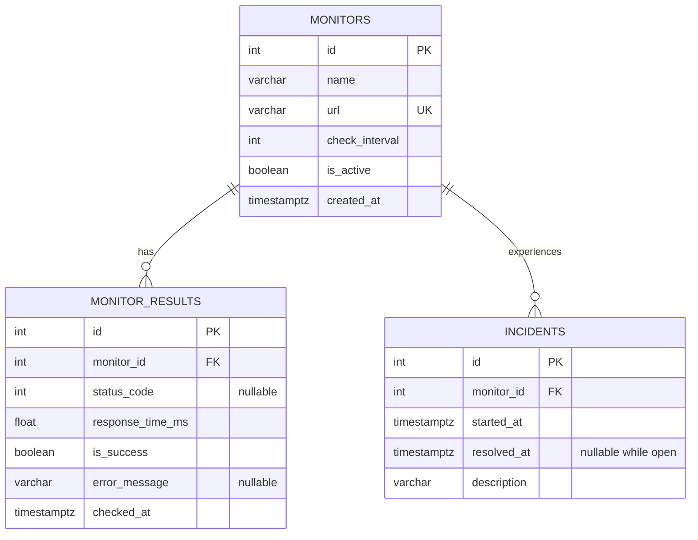

# Database design

## Entity relationships

`monitors` stores endpoint configuration once. `monitor_results` stores one row per completed attempt, so time-series history can grow without duplicating endpoint names and settings. `incidents` represents an outage episode; many failed checks can belong to one incident. There is deliberately no result-to-incident foreign key: incident episodes are inferred by the service and require only a monitor relationship.

## Integrity and indexing

- Integer primary keys identify rows. The URL has a unique constraint to avoid duplicate endpoint registration.
- Required fields are `NOT NULL`; unavailable HTTP codes, errors for successful requests, and unresolved incident end times are nullable.
- Foreign keys reference monitors with `ON DELETE CASCADE`. Deleting a monitor deletes its results and incidents at database level.
- A check constrains intervals to 30–86,400 seconds; another prevents negative latency; resolution cannot precede incident start.
- `(monitor_id, checked_at)` supports per-monitor history and latest-check queries.
- `(monitor_id, started_at)` supports incident history.
- A unique partial index on `incidents(monitor_id) WHERE resolved_at IS NULL` guarantees at most one open incident per monitor.
- PostgreSQL `TIMESTAMP WITH TIME ZONE` stores instants; Python creates UTC-aware values and API responses normalize to UTC. PostgreSQL may display these instants in its session timezone. React formats them in the visitor's local timezone.

The repository commits each result and its incident transition in one transaction. A failed commit rolls back both. Schema creation at startup is convenient for the MVP but does not migrate existing tables when models change.

## SQL analytics

`repositories/analytics.py` contains the production query; `database/queries.sql` provides standalone PostgreSQL versions and an hourly trend example.

The main query starts with monitors and LEFT JOINs results in the chosen time window. Monitors with no checks remain visible. `COUNT(r.id)` avoids counting the empty LEFT JOIN row. Conditional `SUM(CASE WHEN ...)` counts successes. Uptime divides this sum by `NULLIF(COUNT(r.id), 0)`, yielding NULL for no checks rather than a misleading 0% or 100%. AVG, MIN and MAX measure response time across all completed attempts, including failures.

A latest-result subquery operates outside the historical filter so current health is based on the most recent known check. Incident counts use a separate scalar subquery; joining both raw result and incident rows would multiply the aggregates. The incident count includes episodes that **started** in the window, not every episode overlapping it. The UI incident table shows the latest 100 incidents across all time.

The dashboard's overall mean is weighted by each endpoint's check count; averaging monitor averages would give sparse and frequent monitors equal weight. SQL produces the per-monitor aggregates and a small service reduction produces the four summary cards. Detailed response history is queried through the repository, and Recharts plots the latest 500 checks chronologically; it is not an hourly bucketed chart. The standalone `date_trunc` query demonstrates bucketing separately.

## Growth

Five endpoints checked once a minute produce 7,200 rows daily. Retention, pagination across monitors, more efficient latest-state tracking, and measured query tuning would be appropriate before expanding the allowlist substantially. Indexes speed relevant lookups at the cost of write work and storage. Use `EXPLAIN ANALYZE` on representative data before adding more indexes.
